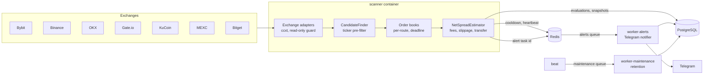

<div align="center">


# Nexus Spread Scanner

**An asynchronous multi-exchange arbitrage spread scanner for centralized crypto exchanges.**

It watches spot markets on Bybit, Binance, OKX, Gate.io, KuCoin, MEXC and Bitget, estimates
the **net** spread after taker fees on both legs, order-book slippage and network transfer
cost, and alerts you on Telegram. Every evaluation is stored in PostgreSQL for later analysis.


</div>

> **Safety.** The bot never withdraws or transfers funds. Version 1 is read-only: every
> authenticated exchange client is wrapped in a runtime guard that blocks any non-GET request,
> and a static (AST) test forbids fund-moving calls in the source tree.

**Status:** MVP / analysis. Stage 1 (detector + alerts) and Stage 1.5 (signal quality & paper
profit validation) are implemented; the multi-day data soak and the GO/NO-GO analysis are next
(net return >= 2 % per month after all costs is the success criterion). Roadmap: [todo.md](todo.md).
Supported exchanges: Bybit, Binance, OKX, Gate.io, KuCoin, MEXC, Bitget (spot, USDT/USDC
quotes). HTX is not supported.

## Documentation

| Topic | Where |
|---|---|
| Rules for contributors and AI agents | [CLAUDE.md](CLAUDE.md), [docs/conventions.md](docs/conventions.md) |
| Current pipeline state | [docs/pipeline/STATE.md](docs/pipeline/STATE.md) |
| Project audit (quality, security, risks) | [docs/audit/00-summary.md](docs/audit/00-summary.md) |
| Decisions | [docs/decisions/](docs/decisions/) |
| User guides (Russian) | [docs/guides/](docs/guides/) |

## Architecture



| Service | Role | Receives secrets |
|---|---|---|
| `migrator` | `alembic upgrade head`, then exits | Postgres |
| `scanner` | market data → net spread → DB → alert queue | Postgres, read-only exchange keys |
| `worker-alerts` | renders and delivers Telegram messages | Postgres, Telegram token |
| `worker-maintenance` | retention cleanup | Postgres |
| `beat` | schedules maintenance | none (broker URL only) |

Each container loads only its own settings class (`nexus.config.roles`) and receives only
its own variables from compose; this is enforced by `tests/unit/test_compose.py`.

### Net spread model

For a reference notional `N` (default $1,000):

1. Walk the **asks** on the buy venue for `N`, round down to the lot step, re-walk for the
   exact cost `C`.
2. Buy taker fee is charged in base; optionally subtract the cheapest common-network
   withdrawal fee (cost of rebalancing inventory — nothing is ever transferred).
3. Walk the **bids** on the sell venue for the remaining base (rounded down); sell taker fee
   is charged in quote → proceeds `P`.
4. `net = P − C`, `net% = net / C · 100`. An alert requires **both** `net% ≥ 0.3` and
   `net ≥ $5` (configurable).

Order books come from REST by default. Both legs of a route that just showed a positive net
spread join a bounded **WebSocket hot-set** (`SCANNER_WS_*`) and are evaluated on streamed books
while they stay fresh; otherwise the scanner falls back to REST.

False-positive guards: stale/skewed books, crossed books, exchange minimums, suspended
deposits/withdrawals (`transfer_unavailable`), a hard gross-spread cap, and a stricter cap
unless both the transfer path and the token contract are verified (ticker collisions).

### Signal quality and paper validation (Stage 1.5)

- **Verified routes only:** alerts require a verified transfer path (withdraw on the buy
  venue, deposit on the sell venue, known fee, no contract conflict). Without a key, Binance
  status comes from its public capital config; Gate.io, KuCoin and Bitget are public.
- **Opportunity episodes:** one alert per continuous run of a route, a re-alert only when the
  net profit grows by `ALERT_REALERT_GROWTH_PCT`, and an "opportunity closed" summary.
  Each new episode is re-checked on REST books after `PAPER_LATENCY_MS` ("survived latency").
- **Automatic quarantine:** a route whose spread persists without a verified transfer path
  (the classic "withdrawals suspended" spread) or whose transfer is unavailable is excluded
  for `QUARANTINE_TTL_H`; it takes no order-book slots and never alerts.
- **Paper trading:** every alert is executed on paper against fresh books with a virtual
  inventory; low balances trigger *virtual* rebalances priced with the real network fee.
  Nothing is ever traded or transferred.
- **Daily digest:** episodes, survived latency, top routes, paper P&L (realized, transfer
  costs, mark-to-market, capital, ROC), quarantines, exchange uptime and transfer coverage.

## Quickstart (local, Version 1)

Setup guide (Russian): [docs/guides/stage-1-local-setup.md](docs/guides/stage-1-local-setup.md).

```bash
cp .env.example .env && chmod 600 .env   # Telegram token/chat id, DB password, optional keys
make up-local                            # build and start the stack
make ps-local                            # all services should be healthy
make logs s=scanner
```

### Extension runs (MEXC, Bitget)

Extension venues run in **public-data mode only (no API keys)**. The key policy check (A6) has no
policy for MEXC and Bitget, so a configured MEXC/Bitget key is refused at startup (exit code 3)
until policies exist. For an extension run, add `"mexc","bitget"` to `EXCHANGES_ENABLED` and leave
all `MEXC_*` / `BITGET_*` variables unset (ADR 0002).

## Development

```bash
uv sync
make check              # ruff + mypy --strict + unit tests
make test-integration   # repositories against PostgreSQL (POSTGRES_* env)
make revision m="..."   # new Alembic migration
uv run pre-commit install   # once per clone: ruff, mypy, gitleaks (v8.30.1, .gitleaks.toml) on commit
```

Project layout:

```
src/nexus/
  config/         per-domain settings groups and per-container role loaders
  domain/         Decimal value objects, spread results, events, errors
  interfaces/     ABCs: market data, repositories, notifier, coordination
  adapters/cex/   ccxt-based adapters + registry (add an exchange here)
  engine/         depth walker, transfer routes, estimator, candidate pre-filter
  scanner/        orchestrator, universe, exchange health
  persistence/    SQLAlchemy models, repositories, Alembic migrations
  notifications/  Telegram notifier and HTML templates
  workers/        Celery app, tasks, dispatcher
  services/       alert delivery and retention use cases
  container.py    composition root
```

### Adding an exchange

Create `src/nexus/adapters/cex/<name>.py` with a registered
`CcxtExchangeAdapter` subclass (set `ccxt_id`, depth limits, passphrase requirement),
import it in `adapters/cex/__init__.py`, add its `<NAME>_API_*` variables to `.env.example`
and compose, and record test fixtures. No orchestrator change is needed.
