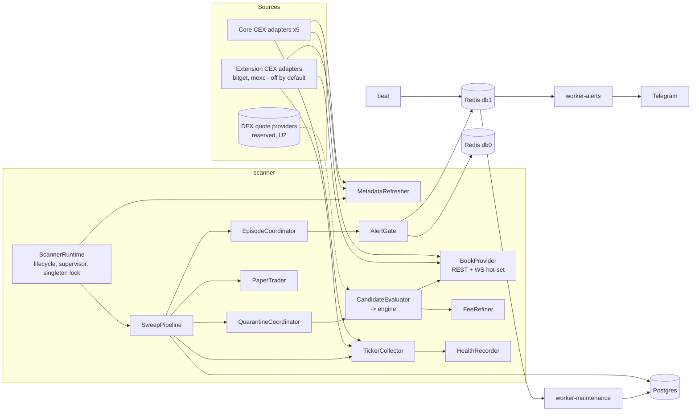

# Target architecture — Nexus Spread Scanner

Date: 2026-10-23. Author: architect (Phase 5). Status: proposed, input for U2.
Baseline: `docs/audit/03-architecture-as-is.md`, `08-data-and-contracts.md`, `13-risk-register.md`.
Decisions: ADR 0001 (no withdrawal), 0002 (bitget/mexc extension), 0003 (modular monolith),
0004 (source plug-in contract), 0005 (clock domains). Migration: `migration-plan.md`.

## 1. Principles

1. **Evolution, not rewrite.** The as-is design is sound (pure Decimal engine, narrow ports,
   composition root, REST re-check before alert). The target fixes the god object, layering
   leaks and async gaps; it keeps the process topology.
2. **Read-only until GO.** No order, withdrawal, transfer or address code (ADR 0001). The
   Stage 2 executor is a *reserved boundary* only (section 7), not built.
3. **Sources plug in, the core does not change** (ADR 0004). Core CEX set = binance, bybit,
   gateio, kucoin, okx. bitget/mexc are extension adapters, off by default (ADR 0002). DEX is a
   reserved plug-in point with no build commitment (U2 decides).
4. **One failure never stops the sweep**; every I/O await has a bound; cancellation is never
   swallowed (section 5).
5. **Analytics must not be optimistic.** Stored numbers feed the GO/NO-GO verdict; unknown costs
   are flagged and excluded from "profitable" (R-03, owned by quant-analyst + backend-lead).

## 2. Runtime topology (unchanged, hardened)

| Container | Role | Holds secrets | Instances |
|---|---|---|---|
| `scanner` | asyncio process: metadata, sweep pipeline, streams, episodes, quarantine, paper | exchange read-only keys | exactly 1 (singleton lock, step C12) |
| `worker-alerts` | Celery: Telegram delivery, digest | Telegram token | 1..n |
| `worker-maintenance` | Celery: retention purge, (later) reaper for stale alerts | none | 1 |
| `beat` | Celery schedule | none | 1 |
| `postgres` | analytics + idempotency + paper state | — | 1 |
| `redis` | db0 coordination (cooldowns, heartbeat, quarantine, lock); db1 Celery broker | — | 1 (auth on, R-09) |
| (later) observability | metrics + dashboards; stack chosen by observability-engineer ADR | — | — |

Celery stays (ADR 0003): its real value is secret isolation (scanner never sees the Telegram
token) and retry/at-least-once delivery. Volume is tiny, so its cost is operational only.
Revisit only if Stage 2 adds a different workload.



## 3. Module boundaries inside the scanner (split of `scanner/service.py`)

Today `Scanner` (1048 lines, 40+ methods) owns everything. Target: each collaborator below is
a class with a narrow constructor, unit-tested alone, wired in `container.py`. `Scanner`
becomes `SweepPipeline` (ordering of stages, ~150 lines) + `ScannerRuntime` (lifecycle).

| Component | Takes over (current methods) | State it owns |
|---|---|---|
| `ScannerRuntime` | `run`, `_until_stopped`, `_announce_start`, shutdown in `finally` | stop event, refresh timer |
| `TaskSupervisor` | `_spawn`, `_latency_checks` | bounded set of background tasks |
| `MetadataRefresher` | `refresh_metadata`, `_record_metadata_stats` | `MarketUniverse` (published read-only) |
| `TickerCollector` | `_fetch_all_tickers` | none |
| `HealthRecorder` | `_record` (+ batched `exchange_health` writes) | per-sweep buffer; uses `ExchangeHealthTracker` |
| `FeeRefiner` | `_fresh_account_fees`, `_fee_lookup_due`, `_fee_lookups`, `_refine_fee`, `_mark_fee_checked` | account-fee cache, attempts, fee semaphores |
| `BookProvider` | `_fetch_book`, `_rest_book_for`, `_confirm_with_rest`, `_update_streams` | per-exchange semaphores, streamed-book counter; owns `OrderBookStreams` |
| `CandidateEvaluator` | `_evaluate_candidates`, `_evaluate` | none (per-sweep tasks) |
| `QuarantineCoordinator` | `_is_quarantined` … `_quarantined_evaluation`, `_route_transfer`, `_announce_quarantines` | new-quarantine buffer, `_parked_at` |
| `EpisodeCoordinator` | `_track_episodes`, `_announce_closed`, `_check_latency` | delegates to `EpisodeTracker` |
| `AlertGate` | `_alert`, `_alert_episode` | none (Redis cooldowns are the state) |
| `PaperTrader` (exists) | `_paper_trade`, `_asset_transfer` glue | portfolio |
| `EventEmitter` | `_emit` | none |

Rules: collaborators never call each other sideways except through `SweepPipeline`; none of
them imports `config.groups` (they receive frozen config dataclasses).

### Package layering (enforced by an import contract in CI, step C10)

```
domain  <-  engine  <-  interfaces(ports)  <-  scanner / services / workers
   ^                         ^
   |                         +-- adapters, persistence, infra, notifications (implement ports)
   +-- config  (only container.py and roles.py turn settings into engine/scanner configs)
```
Fixes B1/B2/B3/I3: `RouteQuote` and portfolio value objects move to `domain`;
`EstimatorConfig.from_settings` moves out of `engine` into the composition layer.

## 4. Data ownership

One writer per table/key; readers listed. Purge is a privileged delete by maintenance only.

| Store | Writer (component) | Readers | Retention / notes |
|---|---|---|---|
| `market_pairs`, `exchange_metadata_stats` | scanner/MetadataRefresher | analytics | stats 7 d; needs time index (D3) |
| `spread_snapshots` | scanner/SweepPipeline | analytics | 7 d |
| `spread_evaluations` | scanner/SweepPipeline | worker-alerts (by id), digest, analytics | 30 d; growth decision after measurement (R-04) |
| `opportunity_episodes` | scanner/EpisodeCoordinator | digest, analytics | 90 d closed |
| `alert_log` | worker-alerts | maintenance reaper | idempotency; add stale-SENDING reaper (R-13) |
| `exchange_health` | scanner/HealthRecorder (batched per sweep) | analytics, dashboards | 7 d; needs time index |
| `route_quarantine` | scanner/QuarantineCoordinator | analytics | 90 d |
| `paper_*` | scanner/PaperTrader | analytics | add retention (D7) |
| Redis `nexus:cooldown:*` | scanner/AlertGate, QuarantineCoordinator | — | TTL |
| Redis `nexus:quarantine:*` | scanner/QuarantineCoordinator | — | source of truth; Postgres = history |
| Redis `nexus:heartbeat:scanner` | scanner/ScannerRuntime | `nexus healthcheck` | 120 s TTL |
| Redis `nexus:lock:scanner` (new) | scanner/ScannerRuntime | — | singleton lease, renewed each sweep |
| Celery payloads | scanner (producer) | workers | add `v` field (I8) |

DB roles (R-09/TD-03): `nexus_scanner` (DML on its tables), `nexus_alerts` (read evaluations,
DML `alert_log`), `nexus_maintenance` (DELETE for purge), `nexus_migrator` (DDL). Analytics and
dashboards use a read-only role. Tests use `nexus_test` only (R-01).

## 5. Async correctness contract

Every new or moved component must satisfy these; tech-lead reviews against this list.

1. **Isolation of fan-out.** Per-exchange work is wrapped so *any* exception (not only
   `ExchangeError`) becomes a recorded failure for that exchange; the sweep continues.
   Use `gather(return_exceptions=True)` or a per-child `try` inside `TaskGroup` (R-02, A3, A4).
2. **No silent drops.** Failed per-route tasks are logged with route key and counted in
   `SweepResult.failed` (A2). `except Exception` only at component edges, always logged.
3. **Cancellation.** Never suppress `CancelledError` of the *current* task. Child cleanup uses
   `cancel()` + bounded `wait`, then re-raise if `asyncio.current_task().cancelling()` (A1).
4. **Every I/O await is bounded.** Exchange: ccxt timeout + outer `asyncio.timeout`. DB:
   `pool_timeout`, asyncpg `timeout`/`command_timeout`, server `statement_timeout` and
   `lock_timeout`. Redis: socket timeouts. Celery send: bounded retries in a thread (R-04, A11).
5. **Background tasks** only via `TaskSupervisor`: bounded size, done-callback logs exceptions,
   cancelled and awaited (bounded) on shutdown.
6. **Backpressure stays explicit:** serial sweeps, bounded candidates, per-exchange semaphore,
   book deadline, bounded WS hot-set. New sources must declare their own limits.
7. **Clock domains** (ADR 0005): monotonic for durations; local receive time for staleness and
   cross-venue skew; exchange timestamps diagnostic only; host clock offset probe at startup
   and periodically, sweep marked degraded above a threshold (R-08, A12).
8. **WS lifecycle:** giving up a stream always unwatches; stream errors feed the exchange
   health tracker; reconnect counts are logged/metrics (A5, A7, A8).
9. **Idempotency:** alerts claimed once per evaluation; stale `SENDING` rows reaped after a
   timeout and marked `FAILED` (alert retried or reported) (R-13, C1).
10. **Heartbeat** = a completed sweep with >= 2 live venues. Liveness ≠ data quality: quality
    (stale share, clock offset, failed routes) goes to metrics, not to heartbeat.
11. **Singleton scanner** via a Redis lease; a second instance waits instead of double-writing (C5).

## 6. Source plug-in contract and DEX readiness (ADR 0004)

- **Registry tiers.** `exchange_registry.register(name, tier="core"|"extension")`. Default
  `EXCHANGES_ENABLED` = the five core venues. Enabling an extension venue is a config change
  only; analytics/soak/GO numbers filter by `tier == "core"` (ADR 0002).
- **Declared capabilities** replace `isinstance` discovery (I2): each adapter exposes
  `capabilities` (`rest_books`, `ws_books`, `account_fees`, `transfer_status`, `server_time`).
  The scanner branches on capabilities, never on names (keeps B6).
- **Leg pricing seam (reserved).** The engine today prices a leg by walking an `OrderBook`.
  The seam for non-book venues is a `LegQuote` (venue, side, amount in/out for a target size,
  fees, gas/network cost in quote, quote timestamp, source kind). CEX legs produce it from the
  depth walk; a DEX provider would produce it from an aggregator/pool quote. `interfaces/dex.py`
  (`BaseDEXProvider`, `DexQuote`) is kept as the placeholder for that port (TD-09: keep).
- **Asset identity** is the hard prerequisite for any DEX or cross-chain leg: a ticker is not
  an asset. A registry `(venue, symbol) -> (asset_id, network, contract)` is needed before a
  DEX leg is meaningful; it also hardens CEX transfer routing.
- **Not built** until U2 says so. If U2 = "DEX later/never", only the registry tiers and
  capabilities are implemented (they pay off for CEX alone).

## 7. Reserved Stage 2 boundary (after GO only)

`executor` would be a separate container consuming *confirmed opportunities* from the scanner
via the broker, owning its own tables (orders, fills, reconciliation) and a `risk` module (limits,
kill switch, stale-data guard). The scanner never gains order code. No withdrawal code at any
stage without a new ADR (ADR 0001). Nothing in this section is in scope now.

## 8. Observability seam

Scanner components report through a narrow `IMetrics` port (counter/gauge/histogram, no-op
default). The backend and dashboards stack is decided by observability-engineer in its own ADR;
the port keeps that decision out of the core.

## 9. What does not change

Pure Decimal engine and its math; REST re-check of streamed legs before alert; Postgres as the
analytics store; Redis + Celery topology; Docker Compose as the run base; Alembic linear chain.
