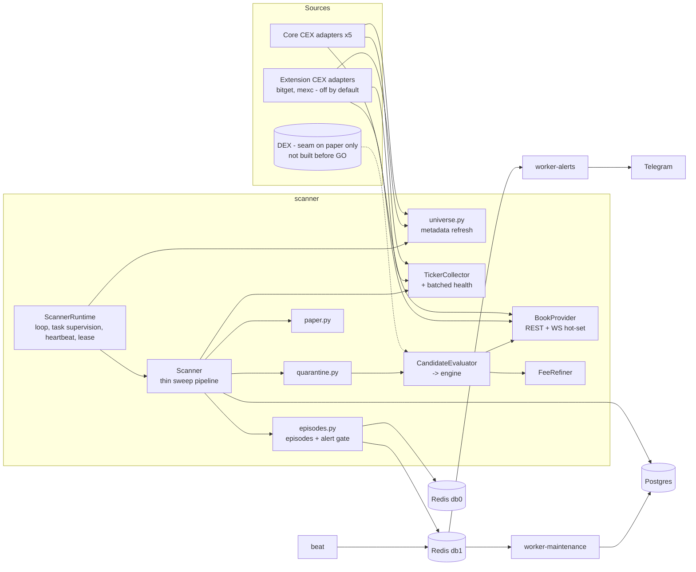

# Target architecture — Nexus Spread Scanner

Date: 2026-10-23. Author: architect. Status: accepted (U2, ADR 0006; revised after critical
review: smaller split, config-based core list, typed capabilities, DEX seam on paper only).
Baseline: `docs/audit/03-architecture-as-is.md`, `08-data-and-contracts.md`, `13-risk-register.md`.
Decisions: ADR 0001 (no withdrawal), 0002 (bitget/mexc extension), 0003 (modular monolith),
0004 (source plug-in contract), 0005 (clock domains), 0006 (U2: DEX seam only, risk-manager).
Migration: `migration-plan.md`.

## 1. Principles

1. **Evolution, not rewrite.** The as-is design is sound (pure Decimal engine, narrow ports,
   composition root, REST re-check before alert). The target fixes the god object, layering
   leaks and async gaps; it keeps the process topology.
2. **Read-only until GO.** No order, withdrawal, transfer or address code (ADR 0001). The
   Stage 2 executor is a *reserved boundary* only (section 7), not built.
3. **Sources plug in, the core does not change** (ADR 0004). Core CEX set = binance, bybit,
   gateio, kucoin, okx (`CORE_EXCHANGES`). bitget/mexc are extension adapters, off by default
   (ADR 0002). DEX: seam described on paper only, nothing built before GO/NO-GO (ADR 0006).
4. **One failure never stops the sweep**; every I/O await has a bound; cancellation is never
   swallowed (section 5).
5. **Analytics must not be optimistic.** Stored numbers feed the GO/NO-GO verdict; unknown costs
   are flagged and excluded from "profitable" (R-03, owned by quant-analyst + backend-lead).
6. **YAGNI for an MVP.** Add a class, port, dependency or service only when a current step needs
   it. The goal is a trustworthy GO/NO-GO verdict, not scale.

## 2. Runtime topology (unchanged, hardened)

| Container | Role | Holds secrets | Instances |
|---|---|---|---|
| `scanner` | asyncio process: metadata, sweep pipeline, streams, episodes, quarantine, paper | exchange read-only keys | exactly 1 (Redis lease, step C10) |
| `worker-alerts` | Celery: Telegram delivery, digest | Telegram token | 1..n |
| `worker-maintenance` | Celery: retention purge, reaper for stale alerts (B12) | none | 1 |
| `beat` | Celery schedule | none | 1 |
| `postgres` | analytics + idempotency + paper state | — | 1 |
| `redis` | db0 coordination (cooldowns, heartbeat, quarantine, lease); db1 Celery broker | — | 1 (auth on, R-09) |
| (later) observability | metrics + dashboards; stack chosen by observability-engineer ADR | — | — |

Celery stays (ADR 0003): its real value is secret isolation (scanner never sees the Telegram
token) and retry/at-least-once delivery. Volume is tiny, so its cost is operational only.
Revisit only if Stage 2 adds a different workload.



## 3. Module boundaries inside the scanner (split of `scanner/service.py`)

Today `Scanner` (1048 lines, ~40 methods) owns everything. Rule (ADR 0003): extract only what
owns state or forms a clear stage; reuse the existing sibling modules; stop when every module is
< ~300 lines and unit-testable alone. `Scanner` keeps its name as the thin pipeline.

| Component | Takes over (current methods) | State it owns |
|---|---|---|
| `Scanner` (slimmed) | `sweep` stage ordering, `_emit` (plain helper) | none beyond collaborators |
| `ScannerRuntime` (new) | `run`, `_until_stopped`, `_announce_start`, `_spawn`, `_latency_checks`, shutdown | stop event, refresh timer, bounded background-task set, lease |
| `TickerCollector` (new) | `_fetch_all_tickers`, `_record` (batched `exchange_health` writes) | per-sweep health buffer; uses `ExchangeHealthTracker` |
| `BookProvider` (new) | `_fetch_book`, `_rest_book_for`, `_confirm_with_rest`, `_update_streams` | per-exchange semaphores, streamed-book counter; owns `OrderBookStreams` |
| `FeeRefiner` (new) | `_fresh_account_fees`, `_fee_lookup_due`, `_fee_lookups`, `_refine_fee`, `_mark_fee_checked` | account-fee cache, attempts, fee semaphores |
| `CandidateEvaluator` (new) | `_evaluate_candidates`, `_evaluate` | none (per-sweep tasks, deadline) |
| `universe.py` (exists) | + `refresh_metadata`, `_record_metadata_stats` | `MarketUniverse` (published read-only) |
| `quarantine.py` (exists) | + `_is_quarantined` … `_quarantined_evaluation`, `_route_transfer`, `_announce_quarantines` | new-quarantine buffer, `_parked_at` |
| `episodes.py` (exists) | + `_track_episodes`, `_announce_closed`, `_check_latency`, `_alert`, `_alert_episode` | delegates to `EpisodeTracker`; Redis cooldowns |
| `paper.py` (exists) | + `_paper_trade`, `_asset_transfer` glue | portfolio |

Rules: dependencies are constructor-injected and acyclic (e.g. `CandidateEvaluator` ->
`BookProvider`, `FeeRefiner`); wiring only in `container.py`; no component imports
`config.groups` (they receive frozen config dataclasses).

### Package layering (checked in CI, step C8)

```
domain  <-  engine  <-  interfaces(ports)  <-  scanner / services / workers
   ^                         ^
   |                         +-- adapters, persistence, infra, notifications (implement ports)
   +-- config  (only container.py and roles.py turn settings into engine/scanner configs)
```
Fixes B1/B2/B3/I3 (audit IDs): `RouteQuote` and portfolio value objects move to `domain`;
`EstimatorConfig.from_settings` moves out of `engine` into the composition layer.

## 4. Data ownership

One writer per table/key; readers listed. Purge is a privileged delete by maintenance only.

| Store | Writer (component) | Readers | Retention / notes |
|---|---|---|---|
| `market_pairs`, `exchange_metadata_stats` | scanner/universe | analytics | stats 7 d; needs time index (D3) |
| `spread_snapshots` | scanner/Scanner | analytics | 7 d |
| `spread_evaluations` | scanner/Scanner | worker-alerts (by id), digest, analytics | 30 d; growth decision after measurement (R-04) |
| `opportunity_episodes` | scanner/episodes | digest, analytics | 90 d closed |
| `alert_log` | worker-alerts | maintenance reaper | idempotency; stale-SENDING reaper (R-13) |
| `exchange_health` | scanner/TickerCollector (batched per sweep) | analytics, dashboards | 7 d; needs time index |
| `route_quarantine` | scanner/quarantine | analytics | 90 d |
| `paper_*` | scanner/paper | analytics | add retention (D7) |
| Redis `nexus:cooldown:*` | scanner/episodes, quarantine | — | TTL |
| Redis `nexus:quarantine:*` | scanner/quarantine | — | source of truth; Postgres = history |
| Redis `nexus:heartbeat:scanner` | scanner/ScannerRuntime | `nexus healthcheck` | 120 s TTL |
| Redis `nexus:lock:scanner` (new) | scanner/ScannerRuntime | — | `SET NX PX` lease, renewed each sweep |
| Celery payloads | scanner (producer) | workers | add `v` field (I8) |

GO/NO-GO analytics read only rows whose exchange is in `CORE_EXCHANGES` (ADR 0002/0004).

DB roles (R-09/TD-03), minimum for the MVP: `nexus_app` (DML, used by scanner and workers),
`nexus_migrator` (DDL), `nexus_ro` (analytics/dashboards, read-only). A per-service split
(scanner / alerts / maintenance) is added only if the security review requires it. Tests use
`nexus_test` only (R-01).

## 5. Async correctness contract

Every new or moved component must satisfy these; tech-lead reviews against this list.

1. **Isolation of fan-out.** Per-exchange work is wrapped so *any* exception (not only
   `ExchangeError`) becomes a recorded failure for that exchange; the sweep continues.
   Use `gather(return_exceptions=True)` or a per-child `try` inside `TaskGroup` (R-02, A3, A4).
2. **No silent drops.** Failed per-route tasks are logged with route key and counted in
   `SweepResult.failed` (A2). `except Exception` only at component edges, always logged.
3. **Cancellation.** Never suppress `CancelledError` of the *current* task. Child cleanup uses
   `cancel()` + bounded `wait`, then re-raise if `asyncio.current_task().cancelling()` (A1).
4. **Every I/O await is bounded.** Exchange: ccxt timeout + outer `asyncio.timeout`. DB:
   `pool_timeout`, asyncpg `timeout`/`command_timeout`, server `statement_timeout` and
   `lock_timeout`. Redis: socket timeouts. Celery send: bounded retries in a thread (R-04, A11).
5. **Background tasks** only via `ScannerRuntime`: bounded set, done-callback logs exceptions,
   cancelled and awaited (bounded) on shutdown.
6. **Backpressure stays explicit:** serial sweeps, bounded candidates, per-exchange semaphore,
   book deadline, bounded WS hot-set. New sources must declare their own limits.
7. **Clock domains** (ADR 0005): `time.monotonic` for durations; local receive time via the
   injected `Clock` for staleness and cross-venue skew (REST stamped at request start);
   exchange timestamps diagnostic only; host offset probe (median over core venues, RTT/2
   corrected) raises a warning/health flag, it does not gate evaluations (R-08, A12).
8. **WS lifecycle:** giving up a stream always unwatches; stream errors feed the exchange
   health tracker; reconnect counts are logged/metrics (A5, A7, A8).
9. **Idempotency:** alerts claimed once per evaluation; stale `SENDING` rows reaped after a
   timeout and marked `FAILED` (alert retried or reported) (R-13, C1).
10. **Heartbeat** = a completed sweep with >= 2 live venues. Liveness ≠ data quality: quality
    (stale share, clock offset, failed routes) goes to metrics, not to heartbeat.
11. **Singleton scanner** via a Redis `SET NX PX` lease; a second instance waits instead of
    double-writing (C5). No fencing/Redlock: single host, single Redis.
12. **Testability:** time via `Clock` + monotonic, I/O via ports; every component testable with
    fakes, no sleeps in unit tests.

## 6. Source plug-in contract and DEX readiness (ADR 0004, ADR 0006)

- **Core list.** `CORE_EXCHANGES` (config constant) = the five core venues and the default of
  `EXCHANGES_ENABLED` (step B1). Enabling an extension venue is a config change only; the
  "core" policy lives in config, not in adapter code.
- **Capabilities resolved at composition.** `container.py` turns each enabled adapter into a
  frozen `VenueHandle` with typed optional ports: `books` (required), `ws_books`,
  `account_fees`, `transfer_status`, `server_time` (`Port | None`). The scanner checks
  `is not None`; no `isinstance` on ports, no venue names in scanner logic (I2, keeps B6).
- **DEX seam — on paper only (U2 option A).** Nothing below is built before GO/NO-GO; steps
  E1-E3 are unscheduled.
  - *Leg pricing seam.* Today the engine prices a leg by walking an `OrderBook`. A non-book
    venue would plug in through a `LegQuote` (venue, side, amount in/out for a target size,
    fees, gas/network cost in quote, quote timestamp, source kind); the CEX depth walk would
    produce the same shape. `interfaces/dex.py` (`BaseDEXProvider`, `DexQuote`) stays as the
    placeholder port (TD-09: keep).
  - *Asset identity* is the hard prerequisite for any DEX or cross-chain leg: a ticker is not
    an asset. Registry `(venue, symbol) -> (asset_id, network, contract)`. May be pulled
    forward for CEX transfer routing only on evidence of network/contract mismatches.
  - The exact `LegQuote` shape is fixed by a new ADR when DEX is revisited after GO, against
    real aggregator data.

## 7. Reserved Stage 2 boundary (after GO only)

`executor` would be a separate container consuming *confirmed opportunities* from the scanner
via the broker, owning its own tables (orders, fills, reconciliation) and a `risk` module (limits,
kill switch, stale-data guard). The `risk-manager` agent writes its specs in `docs/risk/` from
Stage 2 design (ADR 0006). The scanner never gains order code. No withdrawal code at any stage
without a new ADR (ADR 0001). Nothing in this section is in scope now.

## 8. Observability seam

Scanner components report through a narrow `IMetrics` port (counter/gauge/histogram, no-op
default). The backend and dashboards stack is decided by observability-engineer in its own ADR;
the port keeps that decision out of the core. Until then, structured log events are enough.

## 9. What does not change

Pure Decimal engine and its math; REST re-check of streamed legs before alert; Postgres as the
analytics store; Redis + Celery topology; Docker Compose as the run base; Alembic linear chain.
