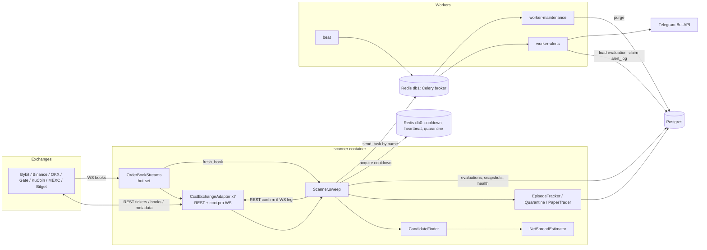

# 03 - Architecture as-is (read-only audit)

Scope: `src/nexus` (about 7.6k LOC), compose file, Celery wiring. `.env` was not read. Nothing was
executed against exchanges; async/runtime claims are from code reading and marked
`[unverified]` when they depend on ccxt/Redis/Celery behavior or on runtime data.
Severity: H/M/L. Confidence: H/M/L.

## 1. Real components

| Component | Where | Role |
|---|---|---|
| Scanner process (`nexus scanner`) | `cli.py`, `scanner/service.py` | One asyncio process. Sweep loop: tickers (REST) -> candidates -> order books (REST or WS hot-set) -> estimator -> persist -> alert dispatch |
| Adapters | `adapters/cex/*.py`, `ccxt_base.py`, `registry.py` | 7 ccxt-based adapters (bybit, binance, okx, gateio, kucoin, mexc, bitget). Read-only; a GET-only guard is installed on `client.fetch` (`ccxt_base.py:75-102`) |
| Engine | `engine/estimator.py`, `depth.py`, `transfer.py`, `candidates.py` | Pure Decimal logic: depth walk, fees, transfer route selection |
| Streams | `scanner/streams.py` | Bounded WS hot-set (`ws_max_streams=20`, TTL 300 s) |
| Episodes / quarantine / paper / health | `scanner/episodes.py`, `quarantine.py`, `paper.py`, `health.py`, `simulation/portfolio.py` | In-memory state mirrored to Postgres/Redis |
| Celery `alerts`, `maintenance` workers, `beat` | `workers/*` | Telegram delivery, daily digest, retention purge |
| Postgres 17 | `persistence/*` | analytics, evaluations, alert idempotency log, paper state |
| Redis 7 (AOF + RDB) | `infra/redis_store.py`, Celery broker (db 1) | cooldowns, heartbeat, quarantines (db 0), broker (db 1) |
| Composition root | `container.py` | wires everything (DIP respected here) |

DEX interface (`interfaces/dex.py`) is declared, never implemented or imported (dead stub, expected for V3).

## 2. Diagram

## 3. Data flows

1. Metadata (every 1800 s, `groups.py:197`): `load_markets` + `load_transfer_info` per exchange concurrently, merged into `MarketUniverse`, upserted to `market_pairs`.
2. Sweep (every >= 10 s, serial, no overlap): `fetch_tickers` for each non-paused exchange (`service.py:787-808`) -> `rank_routes` (O(venues^2) per symbol) -> top-K snapshots to DB -> quarantine filter -> `select(30)` -> parallel book fetch (per-exchange semaphore 4) with a deadline -> estimator -> episodes -> bulk insert evaluations -> alert gate (Redis `SET NX`) -> `send_task`.
3. Alert: worker loads evaluation by id, checks age, `claim` in `alert_log`, renders, sends to Telegram, records SENT/FAILED.
4. Hot-set: positive-net routes are streamed; WS books feed later sweeps, and any alertable evaluation with a streamed leg is re-validated on REST books before alert (`service.py:865-870`, `969-990`). This is a strong design choice.

## 4. Boundary / dependency findings

| # | Finding | Where | Evidence | Sev | Conf |
|---|---|---|---|---|---|
| B1 | `interfaces` depends on `engine` and `simulation` (inverted layering) | `interfaces/repositories.py:17-18` | imports `engine.candidates.RouteQuote`, `simulation.portfolio.*` | L | H |
| B2 | `persistence` depends on `engine` and `simulation` | `persistence/repositories.py` (import grep) | same value objects used as repository DTOs | L | H |
| B3 | `engine` depends on `config.groups` | `engine/estimator.py:23` (`EstimatorConfig.from_settings`) | pure engine imports settings class | L | H |
| B4 | `scanner/service.py` is a 1048-line god object (metadata, sweep, quarantine, fee refinement, episodes, latency checks, paper) | `scanner/service.py` | many `_spawn`, fee semaphores, 40+ methods | M | H |
| B5 | Stray string literal after constant, intended as docstring of `FEE_CACHE_TTL_MS` but placed after `EPISODE_ALERT_KEY_TTL_S` | `service.py:85` | no-op expression, docs misleading | L | H |
| B6 | Orchestrator OCP claim holds: no branching on exchange names found in `scanner/` | `scanner/*` | grep clean | info | M |
| B7 | Domain layer imports only `domain` | import grep | clean | info | H |
| B8 | Celery is used for a single-producer, low-volume task type; justified only by secrets isolation (scanner has no Telegram token). Adds broker, beat, 2 workers; at-least-once semantics complicate idempotency | `workers/*`, compose | design choice | L | M |

## 5. Async correctness

| # | Finding | Where | Evidence | Sev | Conf |
|---|---|---|---|---|---|
| A1 | `_until_stopped` suppresses `CancelledError` while awaiting the child; if the parent task (`run`) is itself cancelled at that moment the cancellation is swallowed | `service.py:257-261` | `with suppress(CancelledError, Exception): await task` | M | M |
| A2 | Exceptions of per-route evaluation tasks are silently dropped (no log) | `service.py:881-886` | filter `task.exception() is None` discards errors | M | H |
| A3 | One exchange raising a non-`ExchangeError` exception in `fetch_tickers` aborts `asyncio.gather`, the whole sweep fails and no heartbeat is written; one bad exchange can make the container unhealthy | `service.py:795-808`; `_call` translates only `IndexError/KeyError/TypeError` (`ccxt_base.py:233`) | e.g. `int(nan)` in ticker timestamp, `AttributeError` | M | M |
| A4 | Same pattern at startup: `refresh_metadata` gathers `load()` that catches only `ExchangeError`; failure leaves empty universe, sweeps produce no heartbeat until next refresh (up to 1800 s) | `service.py:293-308`, `run` 208 | `[unverified]` at runtime | M | M |
| A5 | Stream stop path `_give_up` pops the task but never unwatches the WS subscription; subscription lingers until expiry/prune | `streams.py:155-158` | `_unwatch` only called from `_stop` and error branch | L | H |
| A6 | `watch_order_book` goes through `_call` with `wait_for(2*timeout)` and 3 retries; a legitimately quiet market with no updates can look like a timeout, counts toward 5 errors and the stream is given up | `ccxt_base.py:217-242,530`; `streams.py:128-139` | `[unverified]`, depends on ccxt.pro behavior | M | L |
| A7 | Stream errors do not feed `ExchangeHealthTracker`/rate-limit pause; a banned WS endpoint is retried independently of REST pause | `streams.py:126-151` | no health interaction | L | M |
| A8 | WS reconnect/resubscribe is delegated to ccxt.pro; app-level logic only retries `watch` with 5 s backoff and unwatch on data errors. No explicit ping/pong or reconnect observability | `streams.py` | `[unverified]` | L | L |
| A9 | Orderbook consistency: delta/snapshot sync is fully inside ccxt.pro (checksum only on some venues). Mitigated well: alert only after REST re-check | `service.py:969-990` | design | info | M |
| A10 | Backpressure: sweep loop is serial (`run` 222-233), per-exchange semaphore, deadline `book_deadline_s`, bounded streams (20), bounded candidates (30), bounded fee lookups (3/exchange). Good. No bound on `_latency_checks`/paper tasks, but they are tied to episode opens | `service.py:683-687` | low risk | L | M |
| A11 | Timeouts: ccxt `timeout` set, plus `wait_for(2x)`; fee lookup 2 s; unwatch 2 s; event emit 5 s. Redis `socket_timeout` 5 s. DB: no statement/connect timeout configured on asyncpg engine | `persistence/db.py:27-34` | no `connect_args` timeouts | M | M |
| A12 | Clock sync: no NTP/offset check anywhere (grep of compose/Dockerfile/src). Staleness uses `now - min(exchange_ts, received)` so a lagging exchange clock inflates age (false STALE); a skew check compares exchange timestamps across venues, so inter-exchange clock offset counts as book skew. Fallback to local receive time when ts missing mixes clock domains | `models.py:80-82`, `estimator.py:113-117`, `ccxt_base.py:555` | design | M | M |
| A13 | `CeleryAlertDispatcher` uses `asyncio.to_thread(send_task)`: default thread pool; with broker down each call blocks up to retry policy (about 1.5 s) per alert | `workers/dispatch.py` | bounded by `max_retries=2` | L | M |

## 6. Celery / Redis fit, idempotency, failure tolerance

| # | Finding | Where | Evidence | Sev | Conf |
|---|---|---|---|---|---|
| C1 | Alert claim is at-most-once on crash (documented, deliberate at `interfaces/repositories.py:170-177`): a worker dying after claim and before `record` leaves SENDING; Celery redelivery gets `DUPLICATE`, alert is lost with only an info log. No metric/alarm for rows stuck in SENDING | `persistence/repositories.py:559-577`; `services/alerts.py:76-92` | stuck SENDING never reclaimed | L (M if alerts are the product's only output) | H |
| C2 | Scanner-side episode dedup key `alert:episode:{id}:{n}` (TTL 24 h) is released only if `send_task` raises. If the task is queued but later expires/rejected, that episode alert is never re-sent within 24 h | `service.py:649-666` | by design, trade-off | L | H |
| C3 | Redis single instance holds broker, cooldowns, quarantine; no `maxmemory`/policy configured (default noeviction, OK) but a broker backlog and cooldown keys share fate. AOF + RDB enabled | `docker-compose.local.yml:140` | `[unverified]` for prod compose (only local compose exists in repo) | L | M |
| C4 | Celery visibility timeout left at default (1 h) with `acks_late`; retries use countdown <= 300 s so OK | `workers/app.py:62-66` | ok | info | M |
| C5 | No leader election: two scanner containers would double-process; alerts deduped by Redis, episodes by partial unique index, but in-memory episode state diverges | `container.py`, compose | `[unverified]` operationally | L | M |
| C6 | Single-exchange failure tolerance is good for `ExchangeError` (health tracker, pause, per-exchange fallback to previous markets, stale transfer data downgraded to UNKNOWN). Gaps: A3, A4 | `service.py:293-308`, `health.py` | | info | M |
| C7 | Rate limits: not retried in `_call` (explicit), scanner pauses exchange. Good | `ccxt_base.py:60-62` | | info | H |
| C8 | `worker_init` validates role settings only when `NEXUS_WORKER_ROLE` is set; beat and unknown roles skip validation | `workers/tasks.py:51-58` | | L | M |

## 7. Math observations

Reviewed: `engine/estimator.py`, `engine/depth.py`, `engine/candidates.py`, `engine/transfer.py`, `domain/models.py`, `domain/spread.py`, `adapters/cex/ccxt_base.py` parse helpers.

Positives (verified by reading):
- Decimal end to end. The only `float(` uses are Celery retry countdown (`tasks.py:79`) and Telegram retry_after (`telegram.py:60`). `to_decimal` converts via `Decimal(str(value))`, rejects NaN/inf/bool (`ccxt_base.py:106-119`).
- Fees on both legs: buy fee taken from received base (`base_received = base_bought*(1-f)`), sell fee from quote proceeds (`estimator.py:174,214`). Withdrawal fee in base units subtracted before the sell leg, lot rounding floors the sell amount, remainder counted as lost. Min amount/min cost enforced per leg.
- Slippage: real depth walk (`depth.py`), INSUFFICIENT_DEPTH when the visible book (50 levels) cannot absorb the notional. Crossed/unsorted/non-positive books rejected in `OrderBook.__post_init__`.
- Staleness, skew, sanity caps (`max_gross_spread_pct` 20, `max_unverified_gross_spread_pct` 5), taker fee plausibility (<5 %) all enforced.
- No division by zero path found: `vwap` only used with positive base; `cost > 0` guaranteed before `net_pct`.

| # | Finding | Where | Evidence | Sev | Conf |
|---|---|---|---|---|---|
| M1 | Taker-fee-in-base assumption is hard-coded for the buy leg. Where an exchange charges the buy fee in quote (or deducts via a discount token e.g. BNB/KCS/GT), net is mis-stated by roughly the fee amount (order of 0.1 % of notional) in one direction or the other | `estimator.py:173-174` | no per-exchange fee-currency model | M | M |
| M2 | When transfer status is UNKNOWN (or `include_transfer_cost=False`) the transfer fee is ZERO, so net is overstated for such routes. Mitigated: `require_verified_transfer=True` blocks alerts, and unverified spreads are capped at 5 % gross. But stored evaluations/episodes/digest and `meets_thresholds` (latency "survived") include these optimistic numbers | `estimator.py:179-184`, `domain/spread.py:99-102` | | M | H |
| M3 | USDT and USDC are treated as exactly 1 USD; thresholds ($5) and `net_profit_usd` are quote-denominated. Depeg of either stablecoin is not modeled. Acceptable but should be documented as an assumption | `estimator.py:41`, `groups.py:213-224` | | L | H |
| M4 | Model charges a withdrawal fee on every round trip (move inventory buy->sell). With the stated pre-funded-inventory workflow, real per-trade cost is lower (amortized rebalancing) but inventory drift cost is ignored. Conservative for alerts; not comparable with paper PnL | `estimator.py:179-191` | | L | M |
| M5 | `transfer_fee_usd` is priced at the sell VWAP and includes the chain tax; informational only (the real effect is the reduced `base_sold`). OK but "fee USD" in the breakdown is not additive with buy/sell fees to total cost (slippage/lot loss separate) | `estimator.py:222,246` | | L | H |
| M6 | Slippage reported as `(cost - base_bought*best_ask) + (base_sold*best_bid - proceeds_gross)`; correct for per-leg impact vs top of book | `estimator.py:219` | | info | H |
| M7 | Net percent denominator is buy cost only (not including fees paid/transfer); consistent and conservative relative to threshold semantics, and threshold needs both pct and USD | `estimator.py:218` | | info | H |
| M8 | Candidate pre-filter uses `gross - (f_buy+f_sell)` as upper bound, ignoring transfer cost, so it cannot wrongly discard (correct direction). But pre-filter uses ticker bid/ask with no size, then ranks by fee-bound net; thin top-of-book tickers can crowd the 30-slot budget (starvation of genuine routes) | `candidates.py:77-105` | `[unverified]` empirically | L | M |
| M9 | Fallback taker fee 0.2 % per leg when exchange reports none; flagged via `fees_estimated`. Rate may be higher than real VIP rates and lower than real retail on some venues (e.g. 0.25 %); alerts are not blocked by estimated fees | `ccxt_base.py:277-284`, `estimator.py:131` | | L | M |
| M10 | Decimal context default precision 28: products of large amounts times prices stay exact enough; `floor_to_step` raises precision to 60 locally. No quantization to exchange price/amount precision on VWAP (fine for estimation) | `depth.py:28-33` | | info | M |
| M11 | `to_decimal(entry.get("bid"))` of ccxt floats round-trips through `str(float)`: it keeps repr digits, not the exchange's decimal string. Sub-1e-12 relative error, immaterial at $1000 | `ccxt_base.py:115` | | L | M |
| M12 | REST books for two venues are fetched at different instants (up to the 3 s skew limit); at the default thresholds a 0.3 % net edge can vanish within that window. Alert is "phantom spread" risk; `survived_latency` check (2 s) exists to measure it | `estimator.py:113-117` | | M | M |

## 8. Top risks (ranked)

1. C1 alert lost on crash between claim and send (M/H).
2. A3/A4 one exchange's non-`ExchangeError` failure can stall the whole sweep/health (M/M).
3. M1/M2 net-profit overstated for fee-currency and unverified-transfer cases in stored analytics (M).
4. A12 no clock-sync guard (M/M).
5. A2 silent loss of per-route evaluation errors; A1 swallowed cancellation (M).
6. B4 god-object scanner service (maintainability).
